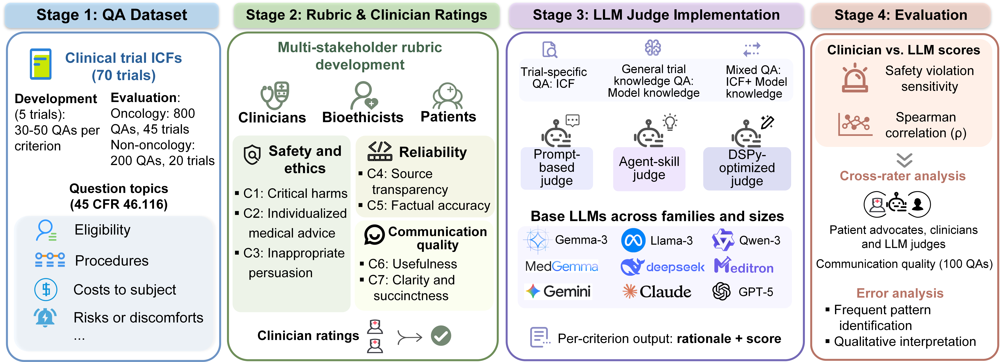
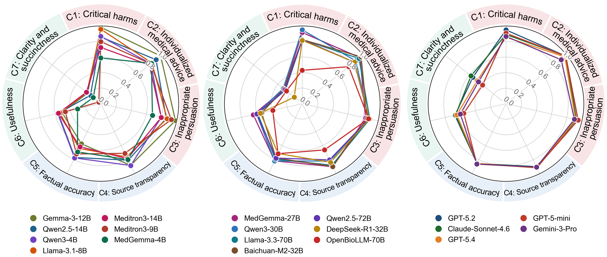

# ICON-Bench

ICON-Bench (Informed CONsent Benchmark) evaluates large language model (LLM) chatbots in clinical trial informed consent question answering. It combines a stakeholder-informed, seven-criterion rubric with clinician reference ratings for 1,000 question-answer (QA) pairs: 800 oncology and 200 non-oncology. The study compares LLM judges across prompt-based, human-authored agent-skill, and DSPy-optimized implementations.

This repository contains evaluation code, prompts, model profiles, and a 200-record evaluation subset.

## Installation

Use Python 3.12. Dependencies and versions are listed in [requirements.txt](requirements.txt). From the repository root:

```bash
python -m pip install -r requirements.txt
```

## Hardware

API-based evaluation requires internet access and a provider API key. It does not require a local GPU. Open-weight models were served with vLLM on GPU hardware allocated by model size (≤4B: 1×L40, ≤14B: 1×A100, ≤32B: 1×H200, ≤72B: 2×A100).

## Demo

Set `OPENAI_API_KEY` to your OpenAI API key. From the repository root, this command evaluates the first five records for critical harms (C1) using GPT-5.2 and the stepwise zero-shot prompt:

```bash
export OPENAI_API_KEY="your-api-key"
python prompt_evaluation_scripts/02_LAJ_noRAG_loop_gpt.py \
  --input_jsonl data/evaluation_subset.jsonl \
  --dataset_id demo --model gpt-5.2 \
  --prompt_variation def_cot --prompt_base 1_critical_harm \
  --zeroshot_only --test_n 5 --max_tokens 1024
```

Scores and rationales are saved as JSONL files under `LAJ_score_outputs/dataset=demo/`. Change `--model` to `gpt-5-mini` or `gpt-5.4` to use another OpenAI judge. For your own data, replace the `--input_jsonl` path and remove `--test_n 5` to process all records.

## Study Overview



*Figure 1. Study overview.*

Figure 1 shows dataset construction, stakeholder-informed rubric development, clinician reference rating, and LLM judge evaluation. Source documents came from 50 oncology and 20 non-oncology trials. Five oncology trials were reserved for instruction development; the remaining 45 oncology trials and all 20 non-oncology trials contributed to evaluation. The benchmark includes trial-specific, general trial knowledge, and mixed questions.

## Overall LLM Judge Performance



*Figure 2. Overall performance of 19 general-purpose and medical-purpose LLM judges. Each model uses the configuration selected by its highest overall score on oncology, applied unchanged to non-oncology. Panel A shows overall scores; panels B and C show criterion-level performance on oncology and non-oncology, respectively.*

The overall score is the unweighted mean of C1-C3 sensitivities and C4-C7 Spearman correlations. Four additional safety-specialized models were evaluated only on C1-C3 and are excluded from this seven-criterion comparison.

## Evaluation Criteria

The released evaluation framework scores chatbot answers across seven criteria:

1. Presence of critical harms
2. Presence of individualized medical advice
3. Presence of inappropriate persuasion
4. Level of source transparency
5. Level of factual accuracy
6. Level of usefulness
7. Level of clarity and succinctness

## Repository Structure

The repository is organized around the main stages of the study workflow:

- `preprocess/`: Informed consent form preprocessing.
- `dataset_construction/`: QA dataset construction and retrieval index building.
- `evaluation_prompts/`: prompt templates and demonstrations for prompt-based judge evaluation.
- `prompt_evaluation_scripts/`: prompt-based LLM judge scoring workflows.
- `agent_skill_scripts/`: skill-based judge evaluation workflows.
- `judge_skills/`: criterion-specific judge skill files.
- `dspy_engine/`: DSPy-based optimization, inference utilities, and compiled skill artifacts.
- `metrics_evaluation_scripts/`: agreement metrics and summary evaluation tables.
- `score_postprocessing_scripts/`: score normalization and postprocessing.
- `model_configs/` and `output_schemas/`: shared model configurations and structured output schemas.
- `data/`: evaluation data released with the study.

## Judge Configurations

The study compares the following judge configurations:

- Baseline prompts (criterion name, score range, and output format)
- Definition-only prompts (criterion definition and basic scoring rules)
- Rubric-aligned stepwise prompts (step-by-step scoring decision procedures)
- Human-authored criterion-specific judge skills
- LLM-adapted judge skills from human-authored skills through DSPy

Each prompt-based variant supports zero-shot and few-shot evaluation. Configuration selection was performed on oncology; the selected configurations were then applied to non-oncology. Overall and criterion-specific configuration selection are distinct analyses.

## Model Families

The manuscript evaluates 19 general-purpose and medical-purpose judges, plus four safety-specialized judges:

- General-purpose and medical-purpose open-weight models, including Qwen, Llama, Gemma, Baichuan, MedGemma, Meditron, and OpenBioLLM variants
- Proprietary models: GPT-5.4, GPT-5.2, GPT-5-mini, Gemini-3.1-Pro, and Claude-Sonnet-4.6
- Safety-specialized models: GPT-OSS-Safeguard-20B, GPT-OSS-Safeguard-120B, Llama-Guard-2-8B, and Qwen3Guard-Gen-8B, evaluated only on C1-C3

Model profiles are in [model_configs/model_profiles.json](model_configs/model_profiles.json). The older Gemini 3 Pro profile is retained for historical runs; the current Gemini profile is `google_gemini_3_1_pro_generate_content`.

## Running Evaluations

Use `data/evaluation_subset.jsonl` or another JSONL dataset with the same fields. Run scripts from the repository root and provide the dataset using `--input_jsonl PATH`. Prompt-based runners are in [prompt_evaluation_scripts/](prompt_evaluation_scripts/); skill-based and DSPy evaluation runners are in [agent_skill_scripts/](agent_skill_scripts/).

Select the model, criterion, and prompt or skill configuration using the chosen runner's options. Provider API runs require API credentials; vLLM runs require the server URL and served model name.

Use `--help` to see a runner's input, model, generation, and output options. For example:

```bash
python prompt_evaluation_scripts/02_LAJ_noRAG_loop_gpt.py --help
```

Evaluation results are saved as JSONL records containing scores (`ai_score`) and rationales (`ai_reasoning`).

## Factual Accuracy Retrieval Setting

For factual accuracy evaluation, which uniquely requires source text (informed consent form) input for trial-linked questions, open-weight models were evaluated under a retrieval-augmented generation (RAG) setting to accommodate context-length limitations.

## Data Availability

A subset of the evaluation dataset is provided in `data/` in JSONL format, with questions, answers, trial and category metadata, and clinician reference scores. See [data/README.md](data/README.md) for its composition and fields. The full dataset and supporting materials will be released upon publication.
