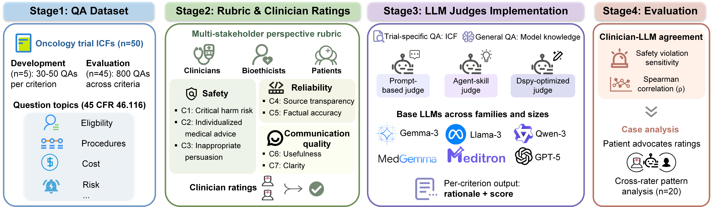
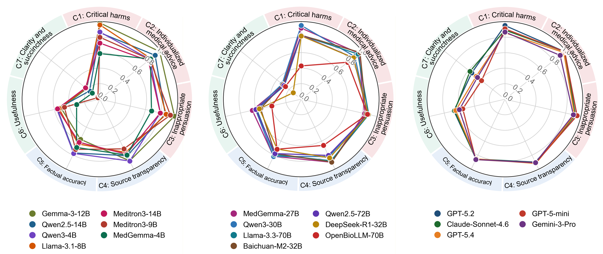

# ICON-Bench 

This repository contains the code accompanying the ICON-Bench study, which evaluates large language model (LLM) chatbots for clinical trial informed-consent question answering and investigates LLM-as-a-judge (LAJ) methods for scalable oversight of patient-facing chatbot responses.

## Study Overview

*Figure 1. Study overview of the ICON-Bench pipeline, spanning dataset construction, rubric development, LLM judge implementation, and clinician-LLM agreement evaluation.*

In this study, we developed a stakeholder-informed evaluation rubric for document-grounded informed-consent question answering, validated it on the Informed CONsent Benchmark (ICON-Bench), and compared multiple LAJ implementations across safety, reliability, and communication quality criteria. ICON-Bench contains 800 question-answer pairs derived from oncology clinical trial informed consent materials.

## Overall LAJ Performance

*Figure 2. Overall LLM judge performance across the seven evaluation criteria under each model's best overall configuration.*

## Evaluation Criteria

The released evaluation framework scores chatbot answers across seven criteria:

1. Critical harms
2. Individualized medical advice
3. Inappropriate persuasion
4. Source transparency
5. Factual accuracy
6. Usefulness
7. Clarity and succinctness

## Repository Overview

The repository is organized around the main stages of the study workflow:

- `preprocess/`: converts informed consent form (ICF) PDFs into Markdown-formatted text and removes recurring structural noise.
- `dataset_construction/`: builds question-answer evaluation materials and constructs the retrieval index used for factual-accuracy experiments.
- `evaluation_prompts/`: stores prompt templates and demonstration files for prompt-based judge evaluation.
- `prompt_evaluation_scripts/`: runs prompt-based LAJ scoring workflows, including no-RAG, oracle, and inline-RAG evaluation.
- `agent_skill_scripts/`: runs skill-based judge evaluation workflows across supported backends.
- `judge_skills/`: contains criterion-specific skill files used in agent-style evaluation.
- `dspy_engine/`: contains DSPy-based optimization and inference utilities, together with final compiled skill artifacts.
- `metrics_evaluation_scripts/`: computes agreement metrics and summary evaluation tables.
- `score_postprocessing_scripts/`: performs score normalization, updates, and release-oriented cleaning steps.
- `model_configs/` and `output_schemas/`: store shared model-profile settings and structured output schemas.
- `data/`: contains publication-facing evaluation data released with the repository.

## Judge Variants Examined

The study compares multiple judge configurations, including:

- prompts that provide only the criterion name and score range
- prompts that provide the criterion definition and basic scoring rules
- prompts that provide rubric-aligned stepwise scoring procedures
- human-authored criterion-specific judge skills
- DSPy-revised judge skills optimized from those human-authored skills

## Model Families

The released pipeline includes runners or artifacts for several model groups:

- general-purpose open-weight models, including examples such as Qwen, Llama, Gemma, and Baichuan variants served with vLLM
- medical-purpose open-weight models, including examples such as MedGemma, Meditron, and OpenBioLLM variants
- proprietary frontier models, including GPT-5, Gemini 3, and Claude Sonnet 4.6
- safety-specialized guard models, which were used only for safety evaluation

## Factual-Accuracy Retrieval Setting

For factual-accuracy evaluation, open-weight models used retrieval-augmented generation (RAG) to accommodate context-length constraints. The retrieval workflow combines dense retrieval, BM25-based sparse retrieval, and reranking before passing supporting evidence to the LAJ judge.

## Release Notes

A peer-review subset of the evaluation data is available in `data/`. The full evaluation dataset will be released after publication acceptance.
